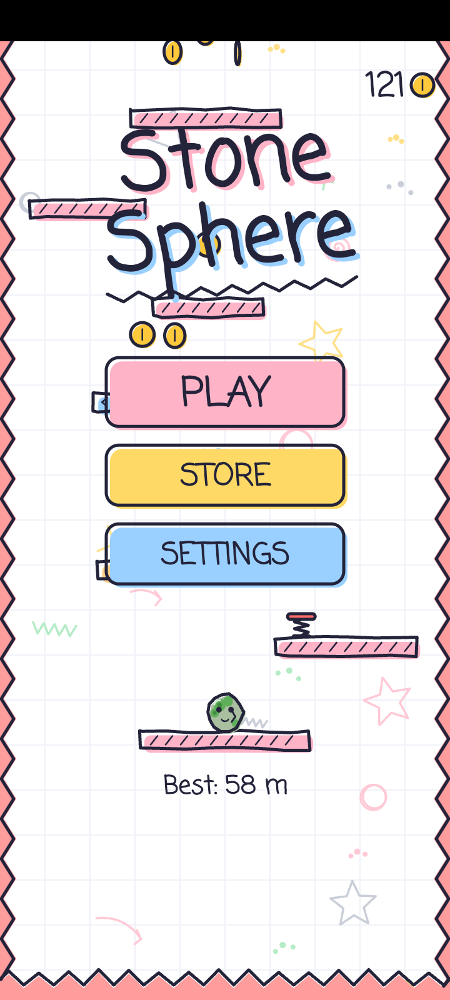
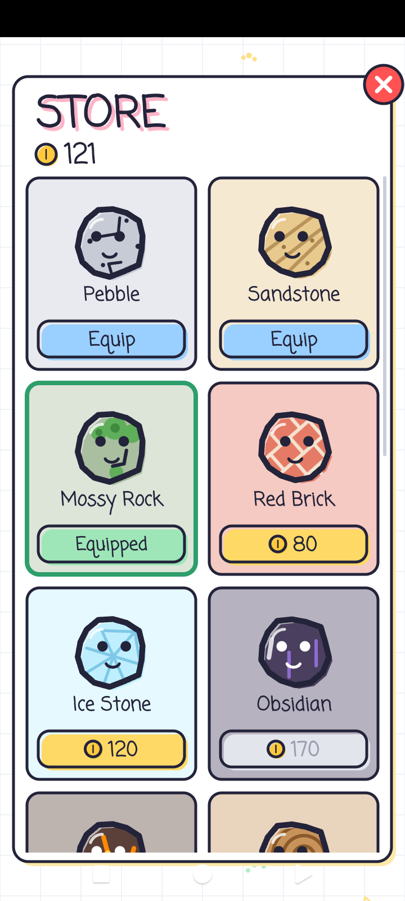
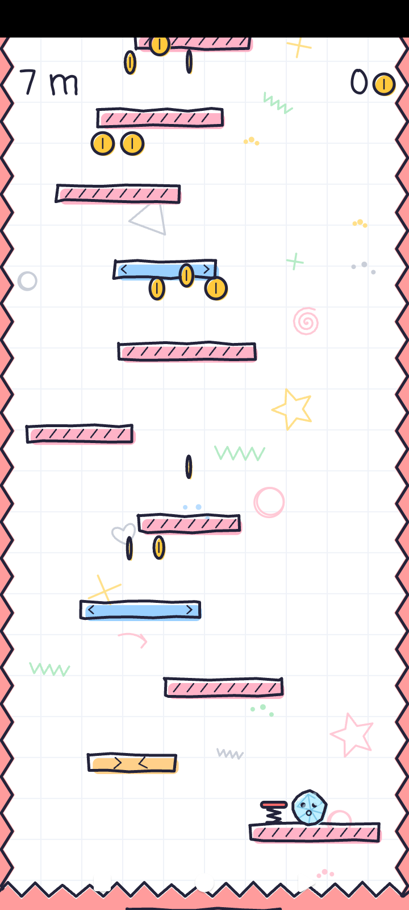

 

  
  
  

### **Jump. Collect. Survive.**
A minimalist arcade experience where every jump matters.

[🌐 Game Page](https://merad-dev.github.io/stone-sphere/) • [⬇️ Download APK](https://github.com/merad-dev/stone-sphere/releases/latest)

---

## Overview

**STONE SPHERE** is a fast-paced Android arcade game built around a focused core loop: control a stone sphere, time your jumps over obstacles, collect coins, and push your personal best.

Every run brings a fresh challenge, and every new record rewards precision and timing.

> **نبذة سريعة (عربي):** لعبة أركيد خفيفة وممتعة للأندرويد تتحكم فيها بكرة حجرية لتجاوز العقبات وجمع العملات وتحطيم الأرقام القياسية.

---

## Features

| Feature | Description |
| :--- | :--- |
| **Gameplay** | Responsive, dynamic jumping mechanics built for quick reflex play |
| **Collection** | Collect coins mid-run to boost your score and progress |
| **Characters** | Unlockable stone sphere styles and variations |
| **Progression** | Escalating, endless arcade challenges |
| **Records** | Local high-score tracking to beat your own limits |
| **Visuals** | Clean, minimalist stone-inspired aesthetic |

---

## Screenshots

  <table>
    <tr>
      <td align="center">
        
      </td>
      <td align="center">
        
      </td>
      <td align="center">
        
      </td>
    </tr>
  </table>

---

## Installation

1. Open the [**Releases**](../../releases) page (or visit the [official game page](https://merad-dev.github.io/stone-sphere/)).
2. Download the latest **STONE SPHERE** `.apk` file.
3. Enable installation from unknown sources on your Android device if prompted.
4. Install and launch **STONE SPHERE**.

---

## Project Information

| Property | Value |
| :--- | :--- |
| **Project** | STONE SPHERE |
| **Developer** | `merad-dev` |
| **Version** | `v1.0.0` |
| **Platform** | Android |
| **Category** | Arcade |
| **Status** | Active Development |

---

**STONE SPHERE**  
*ONE STONE. ENDLESS POSSIBILITIES.*

